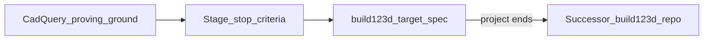
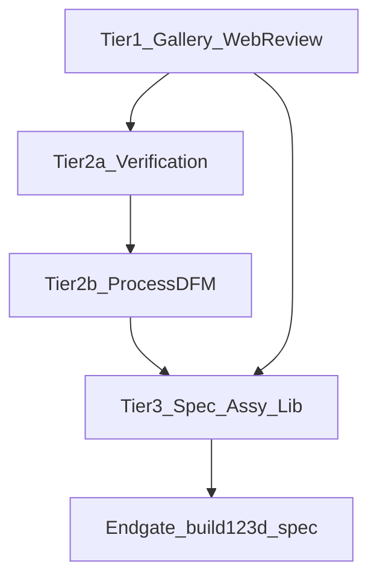

# cad-bot roadmap

Index of planned feature areas for this CadQuery proving ground. Detail files use Problem / Todos / Notes. This index records **what** to build later and **when to stop** — it is not a commitment to implement everything in one pass.

Related process notes: [`docs/verification.md`](../docs/verification.md) · [`docs/postmortems/`](../docs/postmortems/) · [`AGENTS.md`](../AGENTS.md)

## Purpose

| | |
| --- | --- |
| Role | CadQuery sandbox to invent and validate an agentic CAD process: spec → model → DRC/ERC → process DFM → review → handoff |
| Stay on | CadQuery in Docker + uv (in-repo upgrades, e.g. 2.4 → 2.8, are maintenance — not a roadmap tier) |
| Do not | Port parts/skills to build123d; run dual CadQuery + build123d kernels |
| End of project | Accepted [`build123d_target_spec.md`](build123d_target_spec.md) (to be written at endgate) — process contracts a successor repo can implement without inventing the process |

**Not a roadmap item:** [`tripod_head_openbeam_15`](../docs/postmortems/tripod_head_openbeam_15.md) stays archive/postmortem only. Cite it for process evidence (underspecified print orientation, false-green asserts), not as a return-pass milestone.

## EDA-style logical pipeline

Staged, process-aware rule checks — analogous to electronics design automation, not a claim that MCAD is PCB layout.

| EDA concept | Mechanical analogue in cad-bot |
| --- | --- |
| Schematic / netlist | Intent in `drawings/dims.md` (axes, mates, fasteners, **process**) |
| ERC | Spec/intent gates + A/B lock-in before CadQuery |
| Layout | Parametric CadQuery solid + mates (`model.py`) |
| DRC | Geometry validity + metric asserts (volume, BB, probes, interference) |
| DFM / fab stackup | Process-profile packs (FDM vs machining) |
| Gerber / BOM handoff | STEP/STL/(later 3MF) + review archive + BOM |
| LVS | Spec-vs-solid conformance |
| Human ECO | Phase E / gallery review + geometry-hash invalidation |

Verification (DRC/ERC) and process DFM are **separate layers**. Declare process in `dims.md`; run the matching rule pack after export. Do not fold printability into generic geometry asserts.

### Process profiles

Same pipeline slot (`manufacturability` after solid export); different packs:

| Profile | Minimum check themes |
| --- | --- |
| FDM / additive | Bed face / print orientation; overhang & support budget; wall vs nozzle × perimeters; bridges vs cantilevers; tip-over / footprint; print clearances (~0.2 mm) |
| Machining / drilling | Tool access & setup directions; min wall under cutter load; hole depth/aspect; internal corner vs tool; holding / fixture faces |

Implement against CadQuery exports (STEP/STL, trimesh, OCC via `.wrapped`). Study prior art and adapt checklists — do not require build123d-native packages in this image.

## Prior art (study; adapt on CadQuery)

| Source | Relevance |
| --- | --- |
| [augura](https://github.com/pzfreo/augura), [b123d-print](https://pypi.org/project/b123d-print/), [b3d-validate](https://tangled.org/mojzis.bsky.social/b3d-validate) | FDM checklists (overhang, wall, bed-fit, tip-over) — port ideas, not packages that force build123d/OCP 8 |
| [CADGate](https://github.com/vericontext/cadgate) | CadQuery-capable CI: metric diff, DFM rules YAML, rendered PR views |
| [CADCLAW](https://cadclaw.io/) | Assembly verification with severity + evidence (ERC analogue) |
| [Analysis Situs](https://analysissitus.org/featuresext/features_dfm-about.html) | CNC accessibility / thickness / clearance |
| Buildable, Elysium DFX, CADEx MTK, Siemens Check-Mate | Commercial analyze → fix → recheck patterns (reference only) |

### Repo leverage

| Area | Paths |
| --- | --- |
| Gallery / review | `scripts/render_previews.py` (`write_gallery`), `scripts/open_gallery.sh`, `human_review.json` / `REVIEW_SCHEMA_VERSION`, named `cq.Assembly` children |
| Verification | `_point_in_solid` in `parts/tripod_head_openbeam_15/model.py` (generalize as helper only); volume-sum / BB asserts; `assert_previews.py`; postmortem assert hygiene |
| Spec / print intent | `skills/skill_8_language_to_cadquery/reference.md`; process notes in some `dims.md` |
| Assembly | `part_config.load_part_module`, skill_6 mount-type gate, `plate_100x150x5_mcm_1434k33` |
| Library / import | `parts/mcm_*`, `vendor/mcmaster/`, scaffolds |
| Drawing → CAD | skill_5, `parts/kp08/drawings/front_elevation.png` |
| CI | `.github/workflows/ci.yml`, `part_config.resolve()` |

## Tier overview

Every area has **Stop when** (exit) and **Do not continue if** (abort / re-scope). Grinding past stop criteria is out of policy (same spirit as skill_8: re-spec, don’t grind).

| Tier | Slug / focus | Status | Detail |
| --- | --- | --- | --- |
| 1 | `unified_part_and_assembly_gallery` (+ web review / geometry hash) | Planned | [unified_part_and_assembly_gallery.md](unified_part_and_assembly_gallery.md) |
| 2a | `verification_hardening` | Planned | to be written |
| 2b | `manufacturability_process_profiles` | Planned | to be written |
| 3 | `design_spec_lvs`, `assembly_engine`, `part_library`, `drawing_vision` | Later | to be written |
| 4 | Ideas backlog | Backlog | none until promoted |
| Endgate | `build123d_target_spec` | Project end | to be written when process is proven |

---

## Tier 1 — Unified gallery + web review

**Problem:** Gallery is rooted at one `output/<PART>/previews/`; switching models means restarting the server. Human review is TTY-only and does not bind to a geometry hash.

**Prior work:** [unified_part_and_assembly_gallery.md](unified_part_and_assembly_gallery.md); `write_gallery` / Three.js; `human_verify.py` archive schema; named assembly instances.

**Planned extensions beyond the gallery detail file:** in-browser y/n that writes the same `human_review.json` + `docs/reviews/` archive; record a geometry hash (STL/STEP) so reviews invalidate when the solid changes. Keep `PART=<name>` as optional initial selection.

**Depends on:** Existing Phase D previews under `output/` (no on-demand CAD rebuild).

**Stop when:**

- One gallery process serves all built parts/assemblies without restart on selection change
- Model and assembly-component (occurrence) selection work; absent previews show unavailable
- Web review produces archive-compatible JSON including geometry hash
- Phase E TTY path still works or is superseded by a documented web path
- Docs updated (`README`, getting-started)

**Do not continue if:** Gallery rebuilds CAD on demand, or review schema forks from `human_review.json` without a migration plan.

**Detail:** [unified_part_and_assembly_gallery.md](unified_part_and_assembly_gallery.md)

---

## Tier 2a — Verification hardening (DRC / ERC)

**Problem:** Asserts can false-green (probes on empty space, zero-volume cuts); reviews stay “pass” after geometry changes; CI only runs `kp08`; DXF leftovers remain in path helpers.

**Prior work / prior art:** Tripod `_point_in_solid` + postmortem assert hygiene; assembly volume-sum asserts; CADGate-style CI gates.

**Depends on:** Tier 1 geometry-hash review contract (or equivalent hash in review JSON).

**Stop when:**

- Shared probe/assert helpers cover postmortem false-green classes, each with ≥1 exemplar assert
- CI matrix runs all non-archive parts/assemblies
- DXF path removed from templates / skills / scripts (`profile_dxf` leftovers gone)
- Stale reviews fail when geometry hash mismatches

**Do not continue if:** Per-part assert APIs proliferate without a shared module, or CI silently skips failing parts.

**Detail:** `roadmap/verification_hardening.md` (to be written)

---

## Tier 2b — Process-profile manufacturability (DFM)

**Problem:** No process-aware gate after export; FDM overhang/wall/orientation and machining access/holding are not first-class.

**Prior work / prior art:** skill_8 print rules; augura / b123d-print checklists (adapt); Analysis Situs CNC themes; Buildable analyze→recheck pattern.

**Depends on:** Tier 2a shared reporting / fail path; design-spec place for `process: fdm|machining`.

**Stop when:**

- Declaring process in `dims.md` selects a pack
- Each pack documents a minimum check set (FDM: orientation / overhang / wall; machining: access / hole-aspect / wall or holding)
- One CadQuery exemplar per pack produces a structured findings report
- Gate can fail the pipeline on configured severity

**Do not continue if:** Checks stay advice-only with no fail path, or packs require build123d packages in this image.

**Detail:** `roadmap/manufacturability_process_profiles.md` (to be written)

---

## Tier 3 — Spec LVS, assembly engine, library, drawing vision

| Area slug | Problem | Depends on | Detail |
| --- | --- | --- | --- |
| `design_spec_lvs` | Prose/`dims.md` not machine-checked against the solid | Tier 2a/2b | to be written |
| `assembly_engine` | Mates are ad-hoc `cq.Location`; weak interference/BOM contract | Tier 1 component identity; skill_6 | to be written |
| `part_library` | Fasteners/inserts/catalog growth without new process invention | Scaffolds + skills | to be written |
| `drawing_vision` | skill_5 image→dims still manual | Tier 2 stops met | to be written |

**Stop when (per area):**

- Spec schema validates before CadQuery (LVS)
- Assembly interference (and BOM contract) exists for ≥1 multi-body exemplar
- Library additions follow scaffold + skill without inventing new process
- Vision stays deferred until Tier 2 stop criteria pass

**Do not continue if:** Language→CAD invents critical dims again, or assembly work proceeds without Tier 1 component occurrence identity.

---

## Tier 4 — Ideas (backlog only)

Promote only after Tier 2 stops pass, each with its own stop criteria:

- Slicer-in-Docker estimates
- 2D drawing sheets (SVG/PDF)
- Additional process packs (sheet metal, injection, …)

**Stop when:** Explicitly promoted to a numbered tier with **Stop when** / **Do not continue if** — otherwise leave as bullets.

---

## Project endgate — build123d target specification

When process is proven on CadQuery, write and accept [`build123d_target_spec.md`](build123d_target_spec.md). That document **ends this project**. A build123d port lives in a successor repo.

**Stop the project when** all are true:

1. Tier 1 and Tier 2a/2b stop criteria are met
2. Tier 3 items needed for the process story (at least design-spec LVS + assembly interference/BOM contract) are done **or** explicitly waived in the endgate doc with rationale
3. `roadmap/build123d_target_spec.md` covers:
   - Pipeline phases and gate matrix
   - Artifact and review schemas (including geometry hash)
   - Design-spec / process-profile contracts
   - Skill map (agent duties vs code gates)
   - CadQuery → build123d API/responsibility mapping (Workplane → Part/Joints, Assembly patterns, `importStep`, 3MF export)
   - Acceptance tests a successor must pass
   - Non-goals (no McMaster scrape, no host CAD install, …)
4. Human accepts the endgate as “process validated; implement elsewhere”

**Project is done:** No build123d port here, no dual-kernel, no further feature tiers unless a new charter reopens the repo.

**Do not end early if:** Only gallery works while DFM/verification remain advice-only, or the “spec” is a library comparison essay without gate contracts and acceptance tests.

---

## Deferred / out of scope

- OpenSCAD / FreeCAD / TechDraw (dropped early)
- DXF as a pipeline gate
- McMaster CAD download automation / Product API
- Tripod head as a feature milestone
- **build123d implementation** (successor only)
- Dual CadQuery + build123d runtime in this image

## Conventions for new detail files

- Layout: Problem and proposed approach → Todos → Notes and considerations
- Include **Stop when** and **Do not continue if** at the same weight as Todos
- Stable slugs (table above); DFM area = `manufacturability_process_profiles`
- Generated CAD and vendor STEP stay gitignored; no host CadQuery installs
